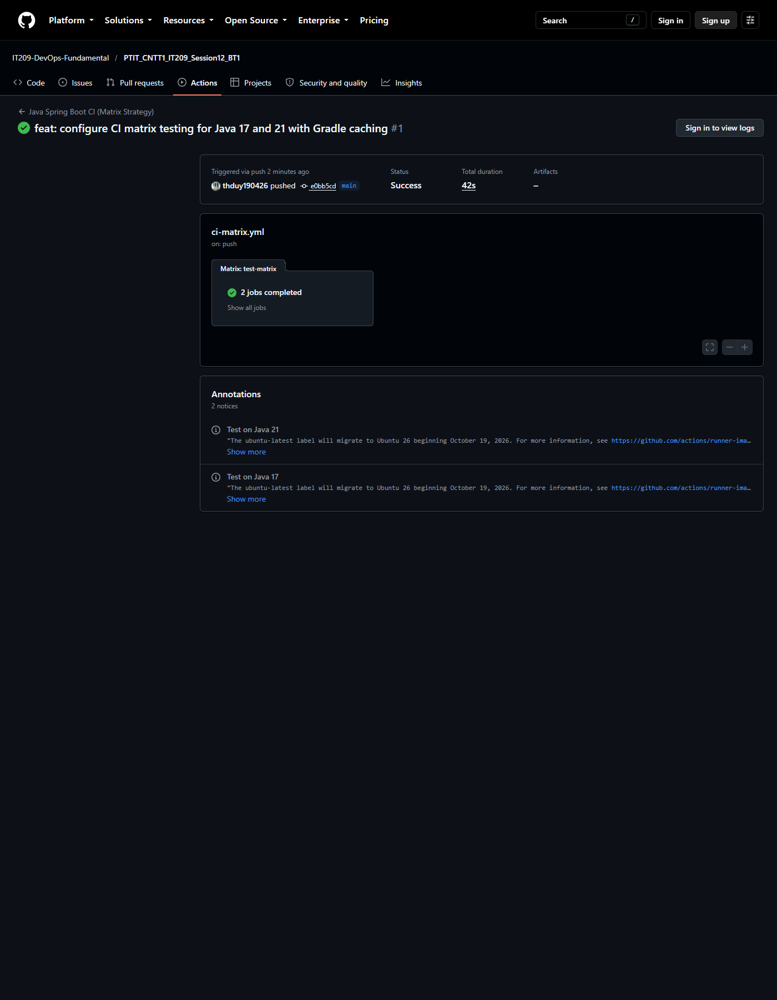
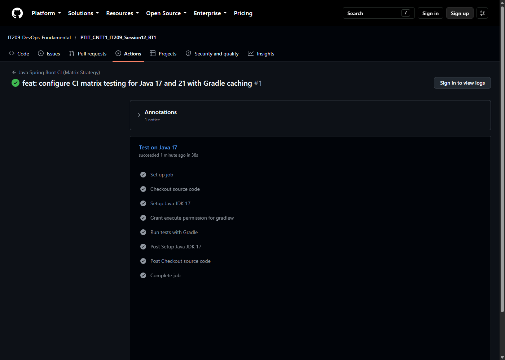
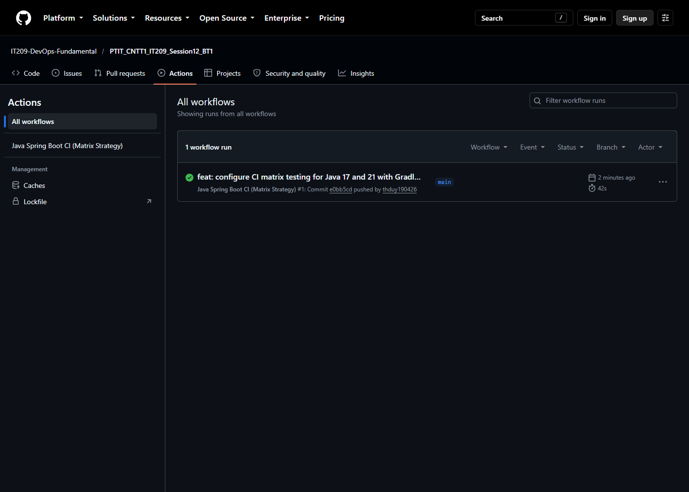

# Bài 1: Quy trình CI đa phiên bản JDK (Matrix Strategy) cho Java Spring Boot Gradle

## 1. Mục tiêu
- Cấu hình ma trận kiểm thử tự động (**Matrix Strategy**) để chạy song song các bài test trên nhiều phiên bản JDK (**JDK 17** và **JDK 21**).
- Tối ưu hóa tốc độ thực thi ma trận với **Gradle Dependency Caching** thông qua `cache: 'gradle'` trong action `setup-java`.

## 2. Kịch bản GitHub Actions Workflow
Tệp kịch bản: [`.github/workflows/ci-matrix.yml`](.github/workflows/ci-matrix.yml)

```yaml
name: Java Spring Boot CI (Matrix Strategy)

on:
  push:
    branches: [ "main" ]

jobs:
  test-matrix:
    name: Test on Java ${{ matrix.java-version }}
    runs-on: ubuntu-latest
    strategy:
      matrix:
        java-version: ['17', '21']

    steps:
      - name: Checkout source code
        uses: actions/checkout@v5

      - name: Setup Java JDK ${{ matrix.java-version }}
        uses: actions/setup-java@v5
        with:
          java-version: ${{ matrix.java-version }}
          distribution: 'temurin'
          cache: 'gradle'

      - name: Grant execute permission for gradlew
        run: chmod +x gradlew

      - name: Run tests with Gradle
        run: ./gradlew test
```

## 3. Kết quả kiểm tra trên GitHub Actions
- **Repository**: [IT209-DevOps-Fundamental/PTIT_CNTT1_IT209_Session12_BT1](https://github.com/IT209-DevOps-Fundamental/PTIT_CNTT1_IT209_Session12_BT1)
- **Workflow Run**: [Run #1 (ID: 38549224198)](https://github.com/IT209-DevOps-Fundamental/PTIT_CNTT1_IT209_Session12_BT1/actions/runs/38549224198)
- **Chi tiết các Sub-job chạy song song:**
  - `Test on Java 17`: **Success (Tích xanh)** - Thời gian: ~38s
  - `Test on Java 21`: **Success (Tích xanh)** - Thời gian: ~37s

### Ảnh chụp màn hình minh chứng:
1. **Luồng Matrix Strategy & 2 sub-jobs hoàn thành tích xanh:**


2. **Chi tiết từng bước thực thi trong sub-job:**


3. **Tổng quan danh sách Workflow Run trong tab Actions:**

